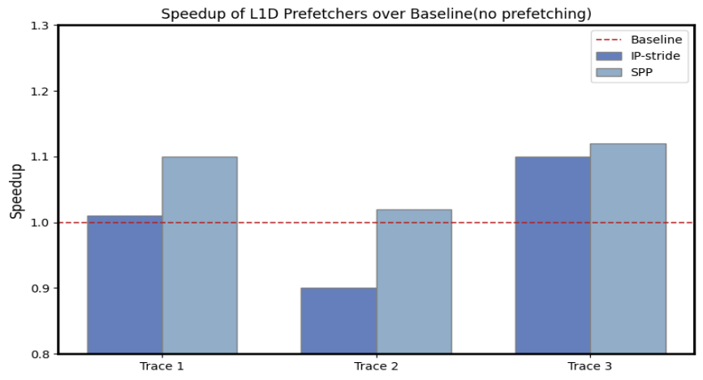
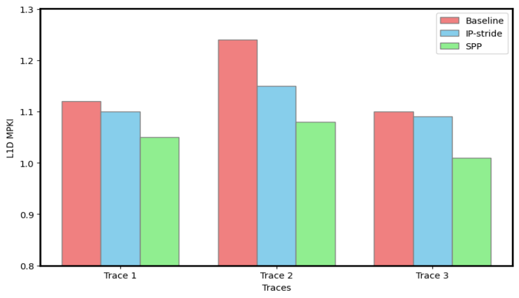
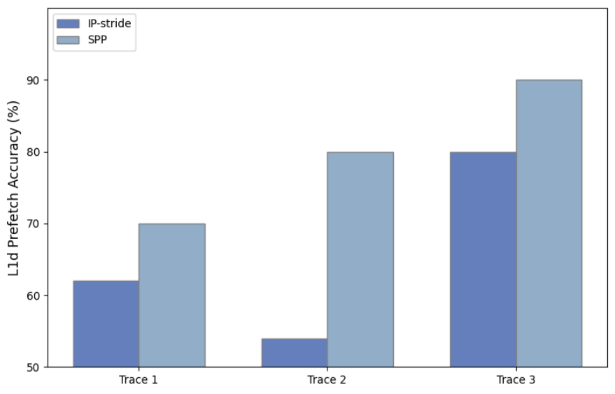
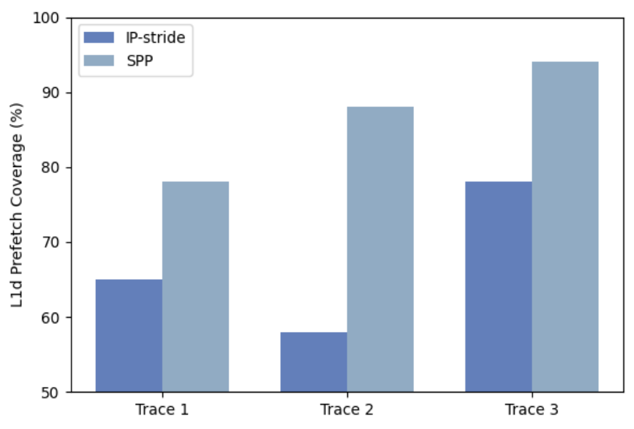

<!-- Converted from PS.pdf with pdf2md (pymupdf4llm). Fixed by hand: formulas (as LaTeX), links, image names, one split table cell, page numbers. PS.pdf is the original. Regenerate: cd PS && pdf2md PS.pdf --images, then redo these fixes. -->

## Programming Assignment II

CS683: Advanced Computer Architecture, Autumn 2026 Computer Science and Engineering Indian Institute of Technology, Bombay CASPER group: https://casper-iitb.github.io/

Prof. Biswa has covered key microarchitecture concepts, including cache hierarchy, cache management policies, and prefetching mechanisms. Let’s proceed from theory to actually implementing and optimising these mechanisms.

In this assignment, you will use the ChampSim simulator to implement/ optimize these techniques and validate their effectiveness using all the benchmark traces provided below.

PA2 GitHub repository: [ChampSim_PA2](https://github.com/cs683-iitb-autumn-2026/PA2-CS683-26.git)
Trace files: [Traces](https://drive.google.com/drive/folders/1zYchkn-M1auZp_l5wRkIzAcDYPkNtW3H?usp=sharing) (Use IITB Account)
ChampSim tutorial: [Video](https://youtu.be/A3XU3jJKqbQ)

The assignment is divided into three major tasks. The task structure points are shown below:

||**Main Tasks**||
|---|---|---|
||**Data Prefetching**||
|Task 1 A|Understanding IP stride code|2 points|
|Task 1 B|Stride Pattern Prefetching (SPP)|4 points|
||**Cache Replacement Policy**||
|Task 2A|Instruction-Conscious L2 Replacement Policy (I-RRIP)|3 points|
|Task 2B|Dynamic I-RRIP|3 points|
||**Data Prefetcher + Cache Replacement Policy**||
|Task 3|Incorporating SPP with Dynamic I-RRIP|3 points|
||Total|15 points|

###### **NOTE** :

- Please read the README carefully. If anyone raises a doubt that has already been mentioned in the README or in PDF, **two points will be deducted.**

- We have already provided template files for each task, and use them to complete the respective tasks.

- **Follow the README to build and execute the binary with the provided traces.**

   - **Execute simulation for:** warmup_instructions= **25M** , simulation_instructions= **25M.**

### _Task 1_

# **Stride Pattern Prefetching**

**Data prefetching** is a technique used in modern processors to hide memory access latency by predicting and loading data into the cache before the CPU demands it. This helps to avoid cache misses, which are expensive in terms of performance. You have studied various prefetchers, including next-line, IP-stride, and stream prefetchers, that capture a constant stride (2,2,2…). However, various applications lack the constant stride or streaming behavior and exhibit non-uniform strides with repeating stride sequences (like 1,2,3)**n** . You need to implement a **Stride Pattern Prefetcher (SPP)** that captures these non-uniform stride patterns.

**Task 1A: Go through and understand the IP Stride prefetcher (as discussed in the class) implementation provided in the GitHub repository. ([prefetcher/ip_stride.l1d_pref](https://github.com/cs683-iitb-autumn-2026/pa2/blob/main/prefetcher/ip_stride.l1d_pref))**

**Task 1B: Stride Pattern Prefetcher (SPP):** This prefetcher shall analyze instruction-level memory access patterns, i.e., they observe memory accesses triggered by individual instruction pointers (IPs). Typically, stride pattern prefetchers (SPP) reside at the L1 data cache level, as they require instruction pointers for pattern training and classification. Your prefetcher should not cross the OS page boundary.

##### **Requirements**

_This section describes the functional constraints, behaviours and objectives that the prefetcher must have._

- Design a prefetching table that must track memory accesses to identify patterns specific to individual IPs. ( Hint: Think of IP-stride prefetcher)

- **Dual Pattern Classification** : The prefetcher should be capable of detecting and separating two types of access patterns for a given IP and issue prefetch requests accordingly.

   - Uniform Strides: constant stride patterns (e.g: A, A+2, A+4, A+6).

   - Non-uniform Strides: Repeating multi-stride patterns e.g: A, A+1, A+3, A+5, A+7, A+10, A+11, A+13, A+15, A+17, A+20… generated by repeating the stride sequence **(+1, +2, +2, +2, +3)****n**

- The prefetcher should prioritize a uniform stride, then go for a non-uniform stride pattern. If an IP exhibits a non-uniform access pattern, the prefetcher should dynamically transition or fall back to non-uniform stride prediction for that IP.

- For non-uniform stride patterns, the design must maintain a signature that represents the sequence of recently observed strides. This signature should map to the next expected stride.

- The prefetcher must support a degree of more than 1.

- **Accuracy-Based Throttling** : Implement an **accuracy checker** as a part of your prefetcher that evaluates the usefulness of prefetches. Dynamically scale the prefetcher degree (aggressiveness) based on its accuracy to prevent cache pollution.

##### **Design** _(Hints)_

- Implement confidence counters or state transitions to detect when a uniform pattern breaks and trigger the transition/fallback to non-uniform prediction.

- Maintain counters for total issued prefetches and useful hits to compute accuracy and adjust prefetch degree.

- Ensure prefetch requests remain within the same page.

- Design a lightweight prefetcher (try to achieve maximum performance with minimal storage overhead) that dynamically adapts to both uniform and non-uniform memory access patterns at the L1D, maximizing coverage and accuracy while avoiding useless prefetches.

###### **Steps to follow:**

- Implement  L1D-based Stride pattern prefetcher (SPP) Look at **_prefetchers/spp.l1d_pref_** file.

##### **Deliverables**

- Report the IPC, speedup, L1D Load MPKI, Prefetch accuracy, coverage values in tabular form, and plot them.

- What is the total storage overhead of your prefetcher?  Provide an exact bit-level breakdown of every entry of your prefetching tables.

- What and how did you decide the threshold for accuracy throttling?

- Why did you choose these particular prefetch degrees for the different accuracy ranges (threshold)?

###### Note:

$$\text{Speedup} = \frac{\text{IPC with Prefetcher}}{\text{IPC of Baseline (no prefetching)}}$$

- **MPKI** = Available in champSim stats
- **Prefetch Accuracy** = Also present in stats

$$\text{L1D Coverage} = \frac{\text{No of L1D Load Misses with Baseline} - \text{No of L1D Load Misses with Prefetcher}}{\text{No of L1D Load Misses in Baseline}}$$

###### Example of required speedup plot:

###### Example of required MPKI plot:

###### Example of required Accuracy plot:

###### Example of required Coverage plot:

### _Task 2a_

# **Instruction-Conscious L2 Replacement Policy (I-RRIP)**

Desktop applications’ instruction footprint fits in the L1I cache, so the CPU frontend [fetch and decode stage] can process instructions without stalling. Unfortunately, this is not the case for server workloads; these applications consist of multiple shared libraries and interact with multiple layers of kernel modules and language runtimes, increasing their code footprint and scaling beyond the L1I cache. Thus, an L2 hit becomes crucial for sustaining performance. So a new class of replacement policies came up that focuses on prioritizing instruction lines at the L2/LLC cache.

Your task is to implement **Instruction-RRIP (I-RRIP) at L2:**

##### **Requirements**

_This section describes the functional constraints, behaviours and objectives that the prefetcher must have._

- You need to extend the **update_replacement_state ( used for insertion and promotion)** function to accept a parameter **, exposing your replacement policy to the information of whether the cache line is an instruction line or not. By default I-RRIP won’t build until you finish this step.**

- Make changes to the three parts of a replacement policy **(insertion, promotion, and eviction)** to prioritize cache lines containing instruction lines over non-instruction lines. Your goal should be to reduce L2 load instruction MPKI.

##### **Design** _(Hints)_

- To identify if a cache block/packet is of instruction type, check its _packet.instruction_ field is set to true or not.

###### **Steps to follow:**

- Implement an instruction-conscious L2 replacement policy.

   - Implement an instruction-conscious replacement policy _replacement/irrip.l2c_repl_

   - Refer _replacement/rrip.l2c_repl_ to understand the code structure of RRIP replacement policy.

##### **Deliverables**

- Report the IPC, speedup, and Load MPKI of L2C, L2 Instruction, and L2 Data in tabular form, and plot them.

- Explain the rationale behind **modifying or not modifying** insertion, promotion, and eviction logic. Defend why your way is the best. Make this section as descriptive and make your communication as clear as you can.

### _Task 2b_

# **Dynamic I-RRIP**

Blindly prioritizing instruction lines over data lines may result in an increase in data misses for certain phases of a workload. So a dynamic approach is much more effective at reducing overall cache misses.

##### **Requirements**

_This section describes the functional constraints, behaviours and objectives that the prefetcher must have._

- Extend your I-RRIP L2 replacement policy that dynamically switches between instruction prioritization mode and regular RRIP mode.

- Implement a **set-dueling** approach as discussed in class, with a few selected leader sets always running the RRIP replacement policy. Track the number of instruction and non-instruction line accesses and misses to these sets.

Hint:  Example formula to decide prioritizing instruction or data lines: $\frac{\text{instr. accesses} + \text{instr. misses}}{\text{total access} + \text{total misses}}$ and compare the result with a static threshold (say 0.25). If greater than the threshold, use your I-RRIP; else use RRIP.

You can further optimize this design by adding your own parameters and modifying the formula.

###### **Steps to follow:**

- Implement a set-dueling-based dynamic IRRIP.

- Implement dynamic instruction-conscious replacement policy _replacement/dyn_irrip.l2c_repl_

##### **Deliverables**

- Conduct a sensitivity study of your decision-making parameters; for example, if you are going with the threshold-based approach as mentioned in the hint, perform sensitivity analysis against 5 different values of the threshold.

- Report the IPC, speedup, and Load MPKI of L2C, L2 Instruction, and L2 Data in tabular form, and plot them.

- Explain the rationale behind your number of leader sets and decision logic. Make this section as descriptive and make your communication as clear as you can.

### _Task 3_

# **Incorporating SPP with Dynamic I-RRIP**

In this task, modify your dynamic I-RRIP policy to incorporate awareness of lines brought in by SPP _(hint: check packet type as PREFETCH or not)_ , outperforming both dynamic I-RRIP and standalone SPP in IPC.

###### **Steps to follow:**

- Implement prefetch awareness in the dynamic instruction-conscious replacement policy _replacement/dyn_irrip.l2c_repl_

##### **Deliverables**

- Report the IPC, speedup, prefetch accuracy, coverage, and Load MPKI of L1D, L2C, L2 Instruction, and L2 Data in tabular form, and plot them.

- Explain the rationale behind handling the prefetch packet by the replacement policy.

# Submission Instructions

- You have to push all the required deliverables to a GitHub repository with proper commit history. Unclear/last-minute commits may result in loss of points.

- **Keep your repository private.**

- You should also submit a single tar.gz file containing your repo (please   don’t   include   trace   files)   with   the   name **_<TeamName_LDAP1_LDAP2…>_pa2.tar.gz_** on Moodle.

- The file should contain the PA2 repository codebase, all tasks’ implementations, generated results, and the Summary.pdf(containing data, plots, and explanations of the logic used for each task).

- Please add detailed comments explaining the logic of your implementation. We will review your code thoroughly as part of the evaluation.

#### **Late submission policy**

- 20% points penalty per day (applies to late submissions on both GitHub & Moodle)

- 0 marks after 5 days

# Deadline

**Deadline** : 15th October, 5 PM
